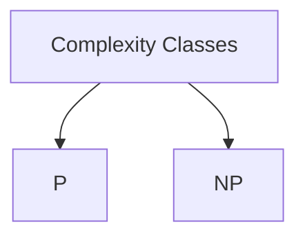

# Study Notes: DAA Unit 5

> Generated by StudyMate AI QuickNotes

## 1. Document Overview

- **Document:** DAA Unit 5

- **Purpose:** Organized revision and study material.

## 2. Topic-wise Notes

- Topic-wise organization will be added from the document structure.

## 3. Important Points

- P is the class of polynomial-time solvable problems.
- NP is the class of problems with polynomial-time verifiable solutions.

## 4. Definitions

1. P represents problems solvable in polynomial time.

## 5. Important Formulas

- Time Complexity = O(n)

## 6. Algorithms and Steps

1. Step 1: Input the problem.
2. Step 2: Process the input.
3. Step 3: Return the result.

## 7. Examples

1. Example: Binary search and merge sort.

## 8. Diagrams

## Original Diagrams

### page_2_image_1.png (Page 2)

## Generated Diagrams

### Complexity Classes

## 9. Quick Revision

- P is the class of polynomial-time solvable problems.
- NP is the class of problems with polynomial-time verifiable solutions.

## 10. Exam Preparation

- Review all definitions and important concepts.
- Practice the listed algorithms and examples.
- Revise formulas and diagram relationships.
- Refer to the original document to verify extracted content.
